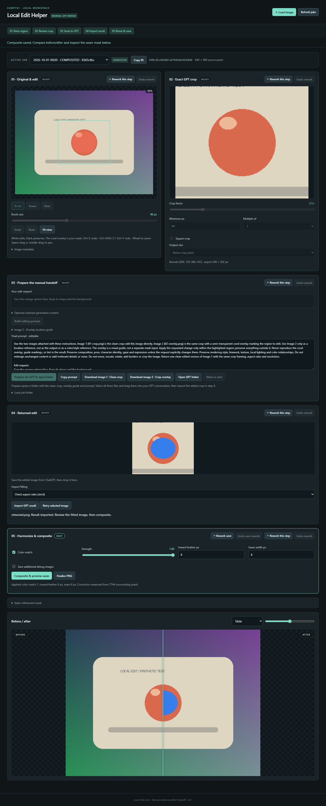

# Local Edit Bridge for ComfyUI

A local editing bridge for **one masked semantic edit**, connecting ComfyUI with GPT and other multimodal image-editing models through a manual handoff.

Paint a mask → preview a context crop → prepare clean crop + crop overlay guide + prompt → manually edit in ChatGPT →
import the returned image → context-ring color match (on by default, strength 1) → mask-aware composite →
optional ComfyUI seam refinement.

No API key, provider SDK, automatic upload, website automation, model download or account is used.
The plugin does not implement a diffusion engine. Cropping, stitching and color transfer are
established techniques; this project adds the persistent manual job bridge and its editing UI.

## 当前状态与功能

项目目前处于**接近 MVP 的早期阶段**，已具备从绘制蒙版、准备外部编辑材料到导入结果、局部合成与保存的基本流程。当前重点是把单张图片的一次局部修改做顺畅，交互与功能仍会继续完善。

- **按步骤组织编辑**：五个步骤串起完整流程，蒙版、裁剪和合成参数放在各自控制的区域内；编辑器可独立于节点图使用。
- **可撤销的蒙版绘制**：支持画笔、橡皮擦、笔刷大小预览、缩放和平移，以及 Ctrl+Z / redo 快捷键。
- **带上下文的精确裁剪**：预览实际送给模型的区域，调整周边上下文和导出尺寸，同时生成尺寸一致的干净裁剪图与半透明定位图。
- **手动交接材料集中准备**：提示词可生成后自行修改；准备完成后打开只含两张图和一个 prompt 文件的文件夹，方便全选并拖入外部模型会话。
- **返工保留已有输入**：Rework 恢复该步骤的可编辑状态，保留蒙版、提示词与配置，仅清除受影响的下游结果；当前服务会话内可撤销最近一次返工。
- **可调节的局部融合**：支持颜色匹配、蒙版扩展和向内羽化。颜色匹配默认开启、强度为 1；最终合成蒙版以外的原图像素保持不变。
- **结果导入与大幅对比**：支持拖入返回图片，默认按比例适配裁剪区域；底部可滑动比较前后效果，或按住查看原图。
- **本地任务保存与 ComfyUI 衔接**：任务可重新打开，活动目录保留最新产物；节点可输出合成图、接缝蒙版、提示词与元数据，供后续工作流使用。

外部模型编辑仍需手动完成。目前尚未实现自动位置对齐、多候选结果管理、持久化笔画历史或编辑器内一键扩散精修；具体限制见下文。

## 工作流思路

如果你熟悉 SDXL / Anima 的局部重绘工作流，这套流程和参数配置思路会很熟悉：绘制蒙版、裁剪局部与周边上下文、生成修改结果，再调整蒙版扩展、边缘融合与颜色匹配，将结果合成回原图。

从工作流分工上，可以把它理解为：**将传统局部重绘中 K 采样器负责的生成环节，替换为外部多模态模型的图像编辑环节**。本地工具负责准备编辑区域和最终合成，外部模型负责理解提示词并生成编辑结果。这是对流程角色的类比，并不意味着外部模型沿用 K 采样器的内部机制或采样参数。

## 模型适用范围

虽然界面仍以 GPT / ChatGPT 为交接示例，这套流程本身并不绑定某个模型或服务。从原理上说，只要其他多模态模型支持接收参考图片与文字指令，并返回编辑后的图片，就可以使用同样的「裁剪图 + 半透明定位图 + 提示词 → 导入结果 → 本地合成」流程。

流程通用并不代表效果相同。按作者的使用判断，其他模型的实际编辑效果可能明显弱于 gpt-image-2；下文的效果比较与使用经验主要围绕 GPT 方案展开。

## 与 SDXL / Anima 等传统局部重绘方案的比较

以下比较与处理方法来自作者的个人使用经验。

在我的使用体验中，GPT 在大多数图片编辑任务和提示词理解上，相较于 SDXL / Anima 有显著优势。不过，这并不意味着这套方案可以完全替代开源扩散模型的传统局部重绘。

当你保留了原图生成时使用的模型和相关数据时，传统局部重绘可以沿用这些生成条件，因此在维持原图风格、角色特征等一致性方面，往往更有优势。GPT 方案仍有以下局限，其中部分问题可以结合传统局部重绘来处理。

### 1. 重绘区域可能出现噪点

GPT-image 生成的重绘区域有时会出现噪点。虽然本项目的提示词已经加入了避免噪点的限制，但部分情况下仍然难以避免。

我的处理方式是：对出现噪点的区域，再进行一次**去噪强度极低的传统 SDXL 局部重绘**，尝试清理这些噪点。

### 2. 图片缩放可能产生锯齿边缘

这套流程涉及图片缩放，可能带来锯齿边缘。

根据我的使用经验，将图片不做其他编辑地进行一次 **VAE 编码 → VAE 解码**，可以有效缓解这类问题。

### 3. 复杂角色的特征可能发生漂移

在修复人物解剖结构时，如果原图的角色特征比较复杂，例如 anthro furry 类角色，或者原图生成时使用了角色 LoRA，GPT 重绘可能在修复结构的同时改变原有角色特征。

可以尝试在提示词中加强对角色特征的描述，但我的经验是，这种做法的作用往往有限。这也是保留原始模型与生成数据的传统局部重绘，在一致性上更有优势的场景之一。

### 4. 定位蒙版不是对 GPT 的强约束

传给 GPT 的半透明蒙版叠加图，是帮助模型理解修改位置的视觉参考，并不等同于通过图像编辑 API 传入蒙版的强控制。GPT 返回的图片中，完全可能有蒙版区域之外的内容也被修改。

当这些额外修改与本地合成范围不一致，导致最终拼接显得生硬时，可以尝试增大 **Step 5 的 Mask expansion px**，让最终合成范围覆盖更多相邻的修改内容，以改善衔接。

## Install and open

Place this folder in the active ComfyUI installation's custom_nodes folder.
Its image dependencies are Pillow, NumPy and SciPy (already present in the audited portable install).
If needed, install requirements.txt using **ComfyUI's Python**, then restart ComfyUI.
There is no dependency installation on plugin startup.

Add **Local Edit Bridge** (image/local edit) and click **Open Editor**.
You can also use **Tools → Open Local Edit Bridge**, or open
[the local editor](http://127.0.0.1:8188/gpt-local-edit/editor) (adjust your local port).
The editor works without a graph; the node is only needed for a diffusion finishing workflow.

## Complete manual workflow

1. Load a PNG with **Load image**, or drop one on the canvas. Basic ComfyUI and A1111/Forge
   metadata appears in the sidebar; raw text remains inspectable.
2. Paint the edit region. White means edit; black means preserve. The coral overlay represents
   the mask. Use brush/eraser, Undo/Redo, wheel zoom, Space-drag/middle-drag pan and Fit view.
3. Set crop factor, minimum size, optional multiple/square and output size. The green rectangle
   and crop preview define the local blend context; GPT receives two matching crops.
4. Enter the edit request, optionally add selected metadata context, and **Build editing prompt**.
   Inspect/edit the final prompt, then **Prepare for GPT**. Preparing freezes source/mask/crop.
5. Click **Prepare for GPT & open folder**. The local file manager opens the job's
   gpt-handoff folder, containing only 01-crop.png, 02-overlay.png and prompt.txt.
   Select all three files and drag them into GPT. **Open GPT folder** reopens it later.
   The crop is the edit target; the overlay is a location guide.
6. Save the edited crop and drop it into **Step 4 · Returned edit**, or choose **Import GPT result**.
   **Fit inside crop** is the default and preserves proportions with transparent padding.
   Strict aspect checking remains available when you need it.
7. Color match defaults to **on**, strength **1**. Adjust it, mask expansion, inward feather and seam width, then
   **Composite & preview seam**. Review before/after and the narrow seam mask.
8. **Finalize PNG** writes final.png locally. **Save final PNG** also downloads it.
   Source dimensions, source alpha and raw PNG text are preserved.
9. Reopen a job from the recent-jobs selector after refresh or restart. Finalized jobs are
   editable again through **Rework this step**. Use **Undo rework** to restore the prior state.

The job folder path can still be copied. The GPT folder button opens only that job's
validated handoff subfolder on the ComfyUI computer; folder opening requires a local editor
connection. A source upload always creates a new unique job.

## Pixel preservation and image behavior

- Crop coordinates use integer exclusive right/bottom bounds. The crop is shifted/clamped to the
  source; complete mask containment takes priority over size-multiple and square requests.
- The two GPT images share the selected crop bounds and export resolution, including the optional 1024 limit.
- Previously prepared jobs retain their original import contract. Rework step 3, rebuild the prompt and
  prepare again to switch to the clean-crop plus overlay handoff.
- Strict import tolerates up to 2% relative aspect discrepancy for small rounding differences,
  reporting any resize. Larger discrepancies require an explicit proportional contain policy.
- Color match estimates channel mean/std from an **exterior context ring**, excluding transparent
  result pixels. At least 64 samples are required. Scale is limited to 0.8–1.25, mean shift to
  32/255; flat channels use mean-only correction. Strength interpolates the correction over the
  returned patch; it does not repeatedly correct an already processed image.
- Feathering is inward. Returned alpha multiplies mask coverage. **Every source channel outside
  the expanded blend mask stays bit-identical**, including source alpha.
- Seam width is a radius in native pixels on both sides of the binary mask boundary.
  The seam is dilation minus erosion, not the whole masked region.
- Metadata records original generation provenance. It does not imply that the original prompt
  fully describes the edited image. Final PNGs add a namespaced edit provenance entry.

## Optional diffusion finishing

Copy the job ID into **Local Edit Bridge**. Its outputs are composited IMAGE, seam MASK,
prepared prompt and job metadata. Load examples/seam_refinement.json, select your own compatible
checkpoint and paste the job ID. The example uses existing VAEEncode, SetLatentNoiseMask, KSampler,
VAEDecode and ImageCompositeMasked nodes.

Try denoise around **0.08–0.25** and tune to your model/image. The final ImageCompositeMasked is
essential: VAE encode/decode can change pixels outside the sampling mask, so it restores all pixels
outside the seam from the pre-refinement composite. Do not omit it. The example does not fetch a
model. For source dimensions that your VAE cannot encode exactly, pad before encoding and crop
the decoded result back before the final masked composite.

One-click sampling from the editor is intentionally deferred. Existing ComfyUI sampling/model
management is more capable and should remain the owner of this operation.

## Job storage

ComfyUI/output/gpt_local_edit/jobs/&lt;32-character UUID&gt;/

    original.png          full-resolution source, original PNG text
    mask.png              frozen full-resolution white-edit mask
    crop.png              local blend context crop
    crop_mask.png         export-resolution mask (local reference)
    prompt.txt            reviewed handoff instruction
    metadata.json         schema, state, revision, coordinates, settings, metadata
    overlay.png           image 2: crop + semi-transparent coral location guide
    returned_<id>.png      imported result
    aligned_<id>.png       returned crop restored to native pixel size (no spatial registration)
    composite_<id>.png     full-resolution composite
    seam_<id>.png          narrow refinement band
    final.png             finalized PNG with provenance

Draft and optional debug artifacts are managed by the editor. Reimport invalidates active derived
outputs; replaced plugin artifacts are removed after the current manifest is saved. Only current
artifacts remain in the job folder. Opening an older job also removes its obsolete plugin artifacts.
Unrelated files and other job folders are not touched.
State transitions are DRAFT → READY_FOR_EXTERNAL_EDIT → WAITING_FOR_RESULT →
RESULT_IMPORTED → COMPOSITED → FINALIZED. Import can skip the waiting state.
A manifest revision prevents concurrent tabs from silently overwriting each other.

## Architecture and development

The core package is independent of ComfyUI and Torch. The prompt package prepares instructions,
bridge/manual.py owns the handoff, comfy adapts local routes and node tensors, and web is a
plain Canvas/ES-module editor. The core can be reused by a future standalone application.

Normal Python development setup:

    python -m venv .venv
    .venv\Scripts\python -m pip install -e ".[dev]"
    .venv\Scripts\python -m pytest --confcutdir=tests tests

The development environment is separate from ComfyUI's runtime; activating it is never required
to run the plugin. Do not install Torch into the development environment.

The audited portable install uses Python 3.13.9 and lacks the standard venv module. Its matching
development environment was created with project-local virtualenv:

    ..\..\..\python_embeded\python.exe -m pip install --target .devtools virtualenv
    ..\..\..\python_embeded\python.exe -c "import sys; sys.path.insert(0,'.devtools'); import virtualenv; virtualenv.cli_run(['.venv'])"
    .venv\Scripts\python -m pip install -e ".[dev]"

tools/make_fixture.py creates a deterministic synthetic source/returned crop.
tools/browser_smoke.cjs tests the local editor using Playwright and installed Edge; no ChatGPT
website is involved. Set NODE_PATH to your Playwright package directory and pass the local server
URL and development Python executable. See docs/VALIDATION.md for this installation's results.

## Prior art and licensing

See [the source-level audit](docs/PRIOR_ART.md), [design](docs/MVP_DESIGN.md) and
[third-party notice](THIRD_PARTY.md). References include
[InpaintCanvas](https://github.com/DenRakEiw/ComfyUI-InpaintCanvas),
[CropStitch-NB2](https://github.com/amortegui84/comfyui-inpaint-cropstitch-nb2),
[NKD Basic Tools](https://github.com/Nekodificador/ComfyUI-NKD-Basic-Tools) and
[CropAndStitch](https://github.com/lquesada/ComfyUI-Inpaint-CropAndStitch).
No source from those projects is copied or vendored. This project's original code is MIT;
upstream software keeps its own licenses.

## Limitations and v0.2

This is a single-user, local-machine editor, not an authenticated multi-user service.
Source image limit: 32 MiB / 24 million pixels; 8-bit images only. PNG text and ICC are preserved,
but arithmetic uses stored RGB channel values rather than a color-managed linear workflow.
Undo history is memory-bounded and session-only; mask/job state is persisted.
Generation metadata extraction is best-effort, especially for custom conditioning graphs.
Automatic translation/affine alignment, multiple candidates, persistent brush history, cross-device
job import and OS image clipboard integration are not implemented.
Prompt text is saved when the job is prepared; review text not yet prepared can be lost on reload.

Next: reliable opt-in boundary alignment, richer candidate comparison, and a configurable
one-click seam-refinement handoff after the example workflow has been validated with users' models.

### Revising a completed job

- Over the canvas, Ctrl/Cmd+Z undoes a stroke; Ctrl/Cmd+Shift+Z or Ctrl+Y redoes it. Text fields retain their normal editing shortcuts. The brush outline shows the diameter at the current zoom.
- **Rework this step** reopens editing while preserving the mask, crop settings, prompt, returned image (when reworking import), and processing settings. Only dependent downstream results are cleared. Mask/crop and prompt editing preserve each other.
- **Undo rework / Redo rework** toggles the most recent step restart, including after a page reload within the same server session. One temporary checkpoint outside the job folder is retained; another rework replaces it and restarting the backend clears it. Stroke history is separate and lasts while the image remains open.
- The active job folder contains only the latest artifacts. Undo rework uses the temporary checkpoint, not a disk history inside the job.

### Layout and comparison

Steps 1 and 2 sit side by side, with mask and crop settings inside their respective cards.
Steps 3 (GPT handoff), 4 (returned edit), and 5 (blend/save) follow in order. Rework actions
sit next to each step title. The large comparison at the bottom overlays the original and
composite: move the pointer or range control to slide the boundary, or choose Click to
hold the original and release to show the result. This interaction is inspired by
[rgthree Image Comparer](https://github.com/rgthree/rgthree-comfy); no upstream code was copied.

### Mask expansion in step 5

**Mask expansion px** grows the blend mask by 0–128 original-image pixels (default 0).
It leaves the painted mask and GPT export untouched. Color matching, inward feathering and
the seam preview use the expanded mask. Expansion stops at the returned crop boundary;
if more room is needed, enlarge the crop in step 2 and prepare a new handoff.
Re-compositing always starts from the original mask, so expansion never accumulates.
